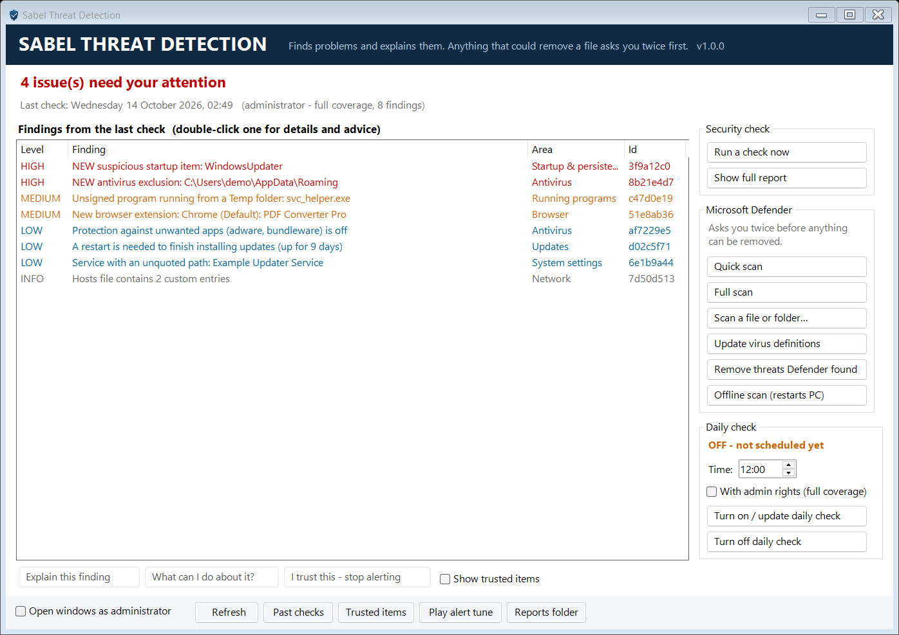

# Sabel Threat Detection



**[Download `Sabel_Threat_Detection.exe`](https://github.com/imnathaniel28/Sabel_Threat_Detection/releases/latest)** and double-click it. That's all: it's a single file with nothing to install.

The scripts are packed inside the `.exe`. On first run it unpacks them as plain, readable files to `%LOCALAPPDATA%\Sabel_Threat_Detection\app` and runs them from there. If you cloned the repo instead, the `.exe` runs the scripts in the repo's `src` folder.

Because the `.exe` isn't code-signed, Windows may show "Windows protected your PC" the first time. Click **More info > Run anyway**, or build it yourself with `tools\Build-Launcher.ps1`.

A **read-only** security check for Windows that runs in the terminal. It looks at your PC once a day, **plays a tune if something needs your attention**, and explains in plain language what each finding means and what *you* can do about it.

Sabel Threat Detection itself **never** deletes, quarantines, "cleans", or changes anything. The only files it writes are its own reports in `%LOCALAPPDATA%\Sabel_Threat_Detection`. The only system change it makes is the daily scheduled task, and only when you run `sabel install`.

If you decide to act on a finding, Sabel Threat Detection can **ask Microsoft Defender** to scan or remove it (see [Acting on a finding](#acting-on-a-finding)). Anything that could lead to a file being quarantined or removed needs **two confirmations**: first `y`, then typing `CONFIRM`.

> Sabel Threat Detection does **not** replace an antivirus. It sits next to Microsoft Defender (or your AV), checks that your protection is actually working, and looks for signs that something has slipped past it.

## The window (double-click)

Double-click **`Sabel_Threat_Detection.exe`**. A window opens showing:
- the result of the last check and a list of findings (double-click one for details and advice)
- buttons to run a check, ask Microsoft Defender to scan or remove threats, and turn the daily check on or off

Every button opens its own **pop-up terminal** where the results appear. All two-step confirmations happen there too. The window refreshes when a pop-up closes or when the daily check produces a new report. Tick **"Open windows as administrator"** for full coverage, or to let Defender remove threats.

`Sabel_Threat_Detection.exe` is a small launcher with the scripts embedded. It unpacks them if needed, then starts `src\Gui.ps1` without leaving an empty console window open. Its source is `tools\Launcher.cs`, and `tools\Build-Launcher.ps1` rebuilds it and the icon. You can right-click it and choose **Send to > Desktop (create shortcut)**.

## Quick start (terminal)

No installation or extra software is needed. It uses the Windows PowerShell 5.1 that ships with Windows 10/11.

```powershell
cd C:\Users\<you>\Documents\Github\Sabel_Threat_Detection
.\sabel scan            # check now
.\sabel install         # check every day at 12:00 (use -Time 18:30 to change)
.\sabel test-alert      # hear the alert tune
```

In PowerShell you need the `.\` prefix, because PowerShell doesn't run commands from the current folder unless you say so. In Command Prompt (cmd), plain `sabel scan` works. To type just `sabel` from any folder, add this project folder to your user PATH.

For full coverage, open **Terminal as administrator** and run `sabel install -Elevated`. Windows only lets administrators read some things, such as antivirus exclusions and the file paths of system processes.

## Commands

| Command | What it does |
|---|---|
| `sabel scan [-Detailed]` | Run all checks now and show results |
| `sabel report [-Detailed]` | Show the latest results again |
| `sabel explain <id>` | Full explanation and step-by-step advice for one finding |
| `sabel trust <id>` / `untrust <id>` / `trusted` | Mark something you recognise as OK so it stops alerting |
| `sabel history` | Past scans |
| `sabel install [-Time HH:mm] [-Elevated]` / `uninstall` / `status` | Manage the daily check |
| `sabel test-alert` | Play the tune and show a test notification |

## Acting on a finding

| Command | What Microsoft Defender is asked to do |
|---|---|
| `sabel act <id>` | Shows the finding and a menu of options that fit it (e.g. scan that exact file) |
| `sabel defender scanfile <path>` | Scan one file or folder |
| `sabel defender quickscan` / `fullscan` | Scan the PC (quick: minutes; full: can take an hour or more) |
| `sabel defender remove` | Remove threats Defender found but did not clean up |
| `sabel defender offline` | Offline scan before Windows starts. **Restarts the PC.** |
| `sabel defender update` | Update virus definitions (removes nothing, so no confirmation) |

Safety rules:
- **Two confirmations every time**, before any action that could quarantine or remove something. Step 1: `y` (just pressing Enter means No). Step 2: type `CONFIRM`.
- **Never runs automatically.** If nobody is at the keyboard (the daily scheduled scan, or piped input), these actions are refused.
- **Defender does the removing**, not Sabel Threat Detection. Quarantined items can be restored from Windows Security > Virus & threat protection > Protection history.
- Every request, confirmation, cancellation and result is logged in `%LOCALAPPDATA%\Sabel_Threat_Detection\actions.log`.
- If another antivirus has replaced Defender, Sabel Threat Detection tells you to use that product instead.

## How the daily check works

1. Task Scheduler runs `Sabel.ps1 scan -Scheduled` every day. If the PC was off at that time, it runs as soon as the PC is back on (`StartWhenAvailable`).
2. The scan runs quietly (~15-30 s) and saves a report.
3. If anything is **Medium** or **High** (and not trusted), it plays a short melody and shows a Windows notification.
4. You decide whether to look: open a terminal and run `sabel report`.

The task runs in your own logged-in session, so you can hear the tune and see the notification. A console window may flash briefly when it starts.

## What it checks (26 checks)

| Area | Checks | Why |
|---|---|---|
| **Antivirus** | Defender / third-party AV on, real-time & behaviour monitoring, Tamper Protection, definition age, last scan, policies that force Defender off, threats detected in the last 30 days (and whether they were really removed), exclusions (new or dangerously broad), PUA blocking | Malware's first move is often to disable or blind the antivirus |
| **Firewall** | Each profile on; inbound default not "Allow" | |
| **System settings** | UAC level, SMBv1 (WannaCry), Remote Desktop + NLA, Secure Boot | |
| **Updates** | Update service disabled, days since last successful update, repeated failures, paused updates, Windows version end-of-support | |
| **Startup & persistence** (MITRE ATT&CK TA0003) | Registry Run/RunOnce/Policies keys, Startup folders, logon scripts, scheduled tasks, services, drivers, WMI event subscriptions, IFEO debugger & SilentProcessExit hijacks, Winlogon Shell/Userinit, AppInit_DLLs, BootExecute, replaced accessibility tools (Sticky Keys backdoor), PowerShell profiles | These are where malware hides so it restarts after every reboot |
| **Running programs** | Fake system processes (e.g. `svchost.exe` outside Windows), look-alike names (`scvhost.exe`), unsigned programs running from Temp/Downloads/Public, processes whose file was deleted, encoded/download-and-run command lines | |
| **Network** | New programs listening for connections, connections to ports used by RATs, hosts-file hijacks, proxy/PAC hijacks | |
| **Accounts** | New administrators, new users, Guest / built-in Administrator enabled, accounts without passwords | |
| **Browser** | New Chrome/Edge/Brave/Firefox extensions, flagging ones with powerful permissions | |
| **System health ("bugs")** | Low disk space, drive health, disk/NTFS errors, blue screens, unexpected shutdowns, apps crashing repeatedly, pending restart | |

### How it decides something is suspicious

- **Digital signatures:** every auto-starting program is checked with Authenticode. Unsigned programs, or ones with a broken signature, count against it.
- **Location:** programs running from Temp, Downloads, Public, the Recycle Bin or the root of AppData are treated as more suspicious than ones in Program Files.
- **Command-line tricks:** it looks for encoded PowerShell, download-and-execute patterns, `mshta`, `regsvr32 /i:http` ("Squiblydoo"), `rundll32 javascript:`, `certutil -urlcache`, `bitsadmin /transfer` and similar "living off the land" techniques.
- **Change detection:** the first scan saves a baseline of startup items, tasks, services, drivers, admins, listeners, extensions and exclusions. Anything that **appears later** is pointed out once, and unsigned newcomers raise an alert.

### Severity levels

| Level | Meaning | Alert tune? |
|---|---|---|
| **High** | Strong sign of compromise or protection switched off | yes |
| **Medium** | Unusual; worth checking soon | yes |
| **Low** | Weakness or oddity; review when convenient | no |
| **Info** | For your awareness (e.g. new signed software) | no |

## Settings

`%LOCALAPPDATA%\Sabel_Threat_Detection\config.json`:

```json
{ "AlertMinSeverity": "Medium", "Sound": true, "Toast": true, "KeepReports": 60 }
```

## Files

```
Sabel_Threat_Detection.exe           single-file app: embedded scripts + launcher (built from tools\Launcher.cs)
src/Gui.ps1                 the window (Windows Forms; actions open in pop-up terminals)
assets/sabel.ico            app icon
tools/Build-Launcher.ps1    rebuilds the icon and the .exe
sabel.cmd                   launcher (starts 64-bit PowerShell; execution-policy bypass for this process only)
Sabel.ps1                   command-line entry point
src/Core.ps1                finding model, signature/location/command-line analysis, baseline, alerts
src/Checks.Protection.ps1   antivirus, firewall, UAC, updates, network exposure
src/Checks.Persistence.ps1  startup locations, tasks, services, drivers, hijacks, WMI
src/Checks.Activity.ps1     processes, network, hosts, proxy, accounts, browser extensions
src/Checks.Health.ps1       disks, crashes, pending restart
src/Report.ps1              scan runner, report rendering, trust list, history
src/Scheduler.ps1           daily Task Scheduler entry
src/Actions.ps1             asks Microsoft Defender to scan/remove, with two-step consent
tests/Test-Detections.ps1   self-test of the detection and consent logic (no system changes)
```

Run the self-test with `powershell -ExecutionPolicy Bypass -File tests\Test-Detections.ps1`.

## Limitations

- It is a heuristic checker, not a malware scanner: it does not scan file contents for virus signatures. Microsoft Defender does that.
- Advanced rootkits can hide from any tool running inside Windows. If you suspect a serious infection, use **Microsoft Defender Offline scan**, which scans before Windows starts.
- Some legitimate software does things that look suspicious. That is what `sabel trust <id>` is for.
- Windows 10/11 only.

## License

Free and open source under the [MIT License](LICENSE). Use it, change it, share it.

## References

- MITRE ATT&CK, Persistence (TA0003): https://attack.mitre.org/tactics/TA0003/
- WMI event subscription persistence (T1546.003): https://attack.mitre.org/techniques/T1546/003/
- Microsoft Defender cmdlets (`Get-MpComputerStatus`, `Get-MpThreatDetection`, `Get-MpPreference`): https://learn.microsoft.com/powershell/module/defender/
- Sysinternals Autoruns: https://learn.microsoft.com/sysinternals/downloads/autoruns
